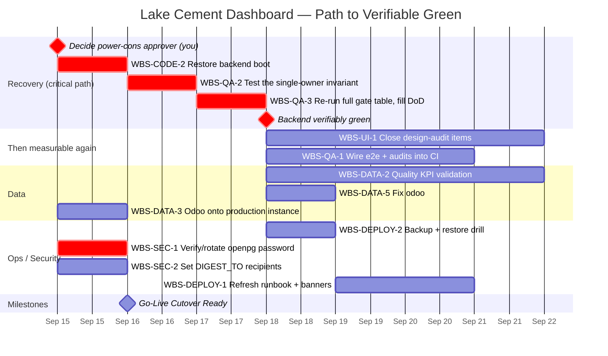

# Schedule — Lake Cement Dashboard

Maintained by the `project-manager` skill's `plan-next-phase` mode. Tasks
reference `WBS.md` IDs; `crit` marks the critical path. GitHub renders this
Mermaid block natively.

**Set 2026-09-13 from the first full audit.** Durations are working
estimates for a solo developer, not commitments. The recovery cluster is
short — the P0 fix itself is small; what gates it is a decision, not effort.

## Reading this honestly

- **The critical path starts with a decision, not a task.** `WBS-CODE-2`
  cannot start until you answer who approves power-cons. Everything in
  "Then measurable again" is gated on it, because those gates literally
  cannot execute against a server that won't boot.
- **Three bars are not really yours to schedule.** `WBS-DATA-3` (production
  Odoo), `WBS-SEC-2` (digest recipients) and, in practice, `WBS-SEC-1`
  (`openpg` rotation) are owned outside this repo — they're drawn as 1-day
  tasks on their raise date because the work *here* is small; the waiting is
  the real duration, and that's tracked in `RAID_LOG.md`, not padded into
  this chart.
- **Go-Live Cutover Ready** depends on the production-Odoo item, so it
  cannot be dated from inside this repo. Treat it as a milestone with a
  dependency, not a date.
